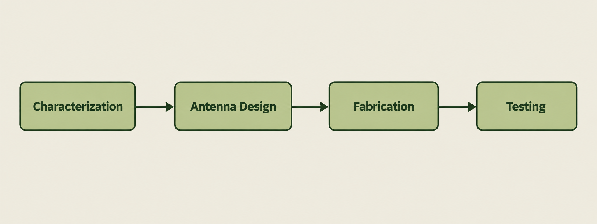
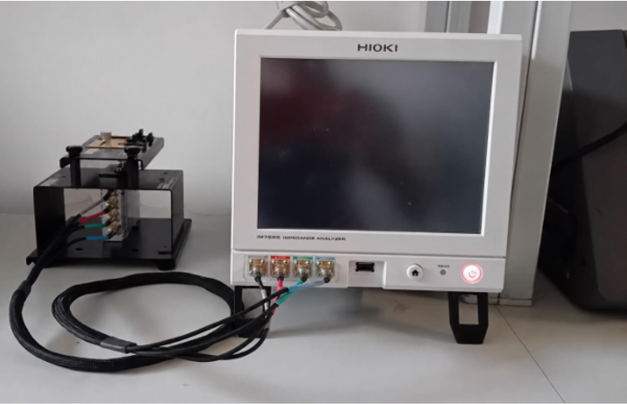
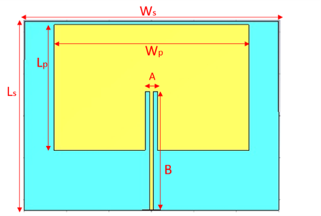
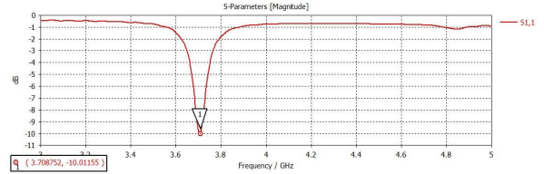
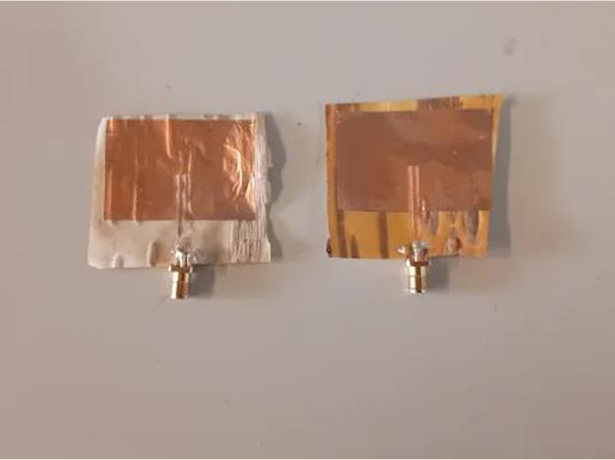
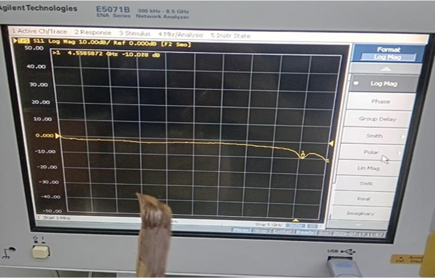

# Birch-antenna
This repo represents a work flow of a producing an antenna made out of birch bark. It consists of determining the electrical characteristics of birch bark, designing an antenna based on determined electrical characteristics, fabricating the antenna and testing it

## Features 
- Characterization
- Testing with VNA
- A method of fabrication

## Work-flow

  

### 1. Characterization
- First step is to determine the electrical characteristics of birch bark and those values are : , thickness and loss factor.
- To determine the values of these parameters HIOKI IM7581 is used.

  

After the measurements we have the following :  = 1.19, thickness = 0.0198mm, loss factor = 0.002

### 2. Antenna design 
- A patch antenna was designed in CST and then it was simulated

  
  

### 3. Fabrication

- For fabrication I used a cutter plotter. The idea is to first shape the copper patch antenna element and then apply the copper sheet onto the birch bark. Before fabrication, I created the antenna design in Adobe Illustrator and sent it to the cutting plotter.

  

### 4. Testing

- For testing I used a VNA. The goal is to see how far is the simulation compared to real.

  

